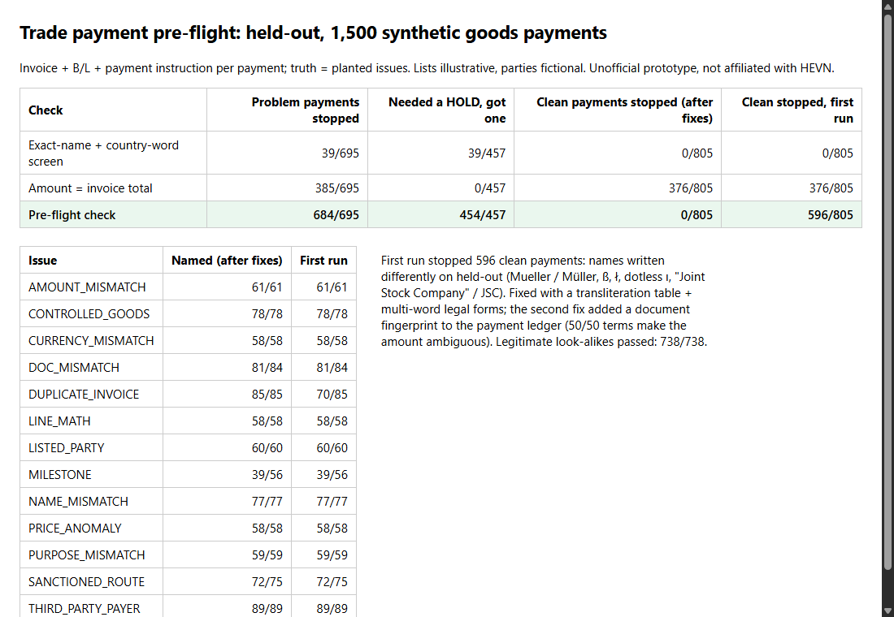

# Trade payment pre-flight: check a goods payment against its documents before it hits the bank

Unofficial prototype by Kushagra Pratap Singh. Not affiliated with HEVN.

## The problem
[HEVN](https://gethevn.com) offers "0% fee SWIFT with a U.S. BIC for Physical Goods Traders" (commodity traders, logistics firms, importers and exporters) and promises "automated payment compliance and documentation".

For goods trade, what holds a payment is the gap between the payment and the trade behind it. Partner and correspondent banks ask questions (RFIs) and hold or return payments when:
- the beneficiary isn't the invoice seller, or a third party is paying;
- the amount doesn't fit the payment terms;
- the remittance says "consulting" while the documents show steel;
- the goods are controlled, or the route touches a sanctioned port;
- the bill of lading (B/L) doesn't match the invoice;
- the same invoice is paid twice.

Each hold costs the trader days of cash and costs the platform support time.

## What I built
`tradeflight` reads the commercial invoice, the B/L and the payment instruction, in two text layouts each. It checks the payment against them, and every finding cites the document field:

| Area | Checks |
|---|---|
| Parties | beneficiary = invoice seller; ordering customer = buyer; B/L shipper/consignee; fuzzy match against a listed-party list. Names are normalised for legal forms (GmbH & Co. KG, Sp. z o.o., S.A. de C.V., JSC…) and transliteration (ü/ue, ß/ss, ł, ı, Ş). |
| Money | currency; line maths (qty × price, sum = total); amount vs the **payment schedule parsed from the terms** (20/80, 30/70, 50/50, 100% advance, against B/L, net N days after B/L); balance only against a B/L dated on or before the value date; **duplicates** by invoice, stage and a fingerprint of the documents in the account's payment ledger. |
| Goods and route | HS codes on a controlled-goods list; unit price outside the reference band (over- or under-invoicing); B/L goods, HS and quantity vs the invoice; ports and transshipment, *and the invoice's delivery place before shipment*, against a sanctioned-area list; "services" wording in the remittance for a goods trade. |

The verdict is one of three:
- **READY**, with an **evidence pack** that answers the usual RFI questions in five lines: what, who, which payment stage, route, and the suggested remittance text;
- **FIX**, with the exact correction (e.g. "Use: 'Payment for INV-… Crude palm oil HS 151110'");
- **HOLD**, for enhanced due diligence.

## Result (held-out: 1,500 synthetic payments, bank committed to git before the first run)


| Check | Problem payments stopped | Needed a HOLD and got one | Clean payments stopped |
|---|---|---|---|
| Exact-name + country-word screen | 39 / 695 | 39 / 457 | 0 / 805 |
| Amount = invoice total | 385 / 695 | 0 / 457 | **376 / 805** (every correct advance) |
| **Pre-flight check** | **684 / 695** | **454 / 457** | **0 / 805** |

- **Look-alikes:** all 738 legitimate look-alikes pass. These are name variants and correct partial payments.
- **By issue:** 11 of 13 issue types are named 100% of the time. The two weaker ones are below.
- **Milestone: 39/56.** Under 50/50 terms the amount fits both the advance and the balance. A balance sent before shipment, with nothing paid yet, looks exactly like an advance. The fix is to ask payers to state the stage.
- **Sanctioned route: 72/75.** A sanctioned *transshipment* port appears only on the B/L, so it can't be seen on an advance paid before shipment.
- **7 extra MILESTONE notes,** all on payments that were already stopped for another reason.

### Honest history (first run vs now)
1. **First held-out run: 596 of 805 clean payments wrongly stopped.**
   - **Cause:** held-out wrote company names in ways dev never had: Mueller/Müller, ß, ł, the dotless ı (which my accent stripping silently deleted), and "Joint Stock Company" / JSC.
   - **Fix:** a transliteration table plus multi-word legal forms. Clean payments stopped: 596 → **0**.
2. **Second fix: duplicates were 70/85.**
   - **Cause:** with 50/50 terms, a re-sent advance looks like a legitimate balance.
   - **Fix:** the payment ledger now keeps a fingerprint of the documents behind each payment. Duplicates: **85/85**.
3. **Both fixes came after looking at held-out failures.**
   - The first run is saved unchanged in `out/heldout_first_run.json`.
   - The dev bank still shows 0 false stops after the fixes.

### Example (`python demo.py`, abridged)
```
=== a services purpose on a goods shipment
  Remittance information: IT support services
  -> FIX  PURPOSE_MISMATCH: remittance says 'IT support services', documents are goods (Crude palm oil).
          Use: 'Payment for INV-92030075 Crude palm oil HS 151110'
=== same invoice + B/L submitted again
  -> HOLD DUPLICATE_INVOICE: the same invoice and B/L already backed a payment of 695,298.86; this would bring it to 1,390,597.72 of 869,123.58
=== a clean balance payment with name variants (JSC, G.m.b.H.)
  -> READY  evidence pack: Underlying trade INV-71030001 … This payment: EUR 695,298.86 = balance under '20% advance, 80% against B/L copy' …
```

## Honest limits
- **Illustrative lists.** The controlled-goods, sanctioned-place and listed-party lists are illustrative and the parties are fictional. A real deployment plugs in OFAC/EU/UN lists and an HS-based export-control mapping. This is not compliance advice.
- **Perfect price reference.** Price bands come from the same ranges the generator uses. A real system needs a reference price source, such as customs unit values.
- **Clean input text.** Documents arrive as clean text in two layouts per document. Real PDFs need extraction in front of this.
- **Nothing real touched.** No HEVN API, account or data was used.

## Run it (Python 3.10+, stdlib only)
```
python demo.py              # four held-out payments with verdicts, reasons and an evidence pack
python evaluate.py          # held-out scores -> out/heldout.json   (--dev for the dev bank)
python -m pytest -q tests   # 7 tests
```

## Files
- `tradeflight/check.py`: parsers, entity matching, payment schedule, all checks, verdict, evidence pack
- `tradeflight/synth.py`: trade and document generator with planted issues and benign look-alikes
- `eval/bank_heldout.py`: held-out bank, the first commit
